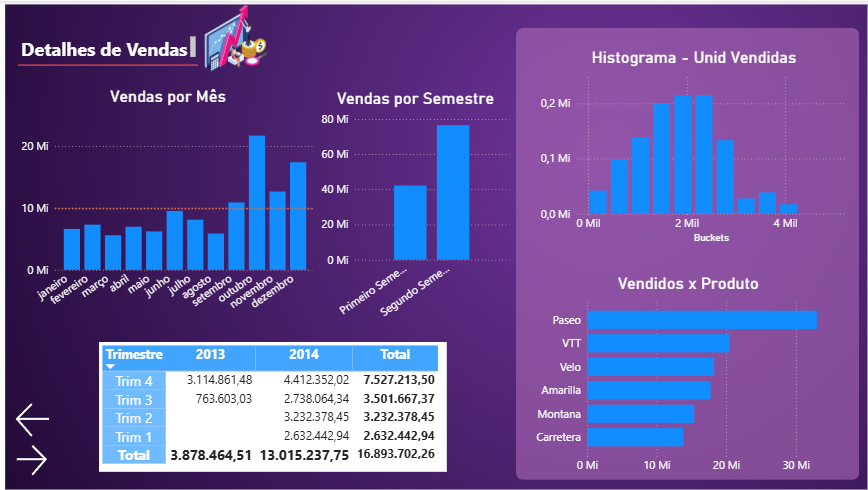
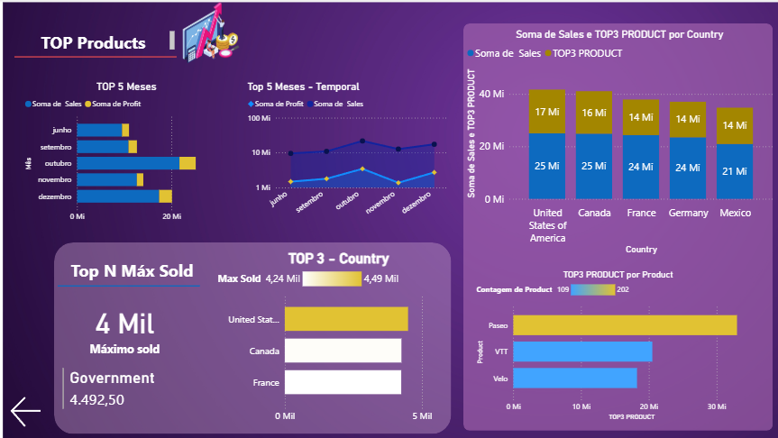

# 📊 Power BI: Atualização de Relatório Financeiro com Foco em UX/UI

Este projeto faz parte do desafio prático de Business Intelligence com foco na otimização da Experiência do Usuário (UX) e Design de Interface (UI) em relatórios corporativos no Power BI.

---

## 🎯 Objetivo do Projeto

Aprimorar um relatório analítico existente aplicando conceitos avançados de usabilidade, hierarquia visual, distribuição de elementos baseada na proporção áurea, contraste de cores (Dark Theme) e navegação fluida entre páginas por meio de botões customizados.

---

## 📱 Estrutura e Páginas do Relatório

O relatório foi refinado para entregar uma navegação intuitiva e rica em insights visuais:

### 1. Detalhes de Vendas
* **Visuais**: Gráficos de vendas mensais e semestrais, histograma de unidades vendidas (*Histogram - Unid Vendidas*), ranking de vendas por produto e matriz detalhada por trimestre[cite: 8].
* **Destaques de UX**: Tema escuro padronizado, botões de navegação lateral limpos e alinhamento focado na legibilidade rápida dos dados.

  

### 2. TOP Products (Análises de Destaque)
* **Visuais**: Gráficos de barras horizontais dos Top 5 Meses, análise temporal de lucro e vendas, gráfico empilhado de vendas por país (*Soma de Sales e TOP3 PRODUCT*), cartões de destaque (*Top N Máx Sold*) e ranking de produtos principais.
* **Destaques de UX**: Uso de cores contrastantes (tons de amarelo/dourado e azul) para destacar itens principais (*Top N*), mantendo a harmonia visual do tema.

  

---

## 📐 Princípios de Design Aplicados

* **Contraste e Hierarquia Visual**: Fundo escuro com elementos e gráficos em tons vibrantes para guiar o foco do usuário instantaneamente aos KPIs mais relevantes.
* **Navegação Intuitiva**: Implementação de menus de navegação laterais e botões de retorno padronizados em todas as páginas.
* **Segmentação e Agrupamento**: Organização modular dos visuais para evitar poluição visual e facilitar a leitura cruzada de dados.

---

## 🚀 Como Executar o Projeto

1. Faça o download do arquivo `.pbix` localizado na pasta `src/`.
2. Abra o arquivo no **Power BI Desktop**.
3. Navegue entre as páginas utilizando os botões interativos integrados no layout.

---

## 👤 Autor

* **Maycon Douglas da Silva**
* [LinkedIn](www.linkedin.com/in/maycon-silva-5721a2186) | [GitHub](https://github.com/maycondouglasnavy-prog)